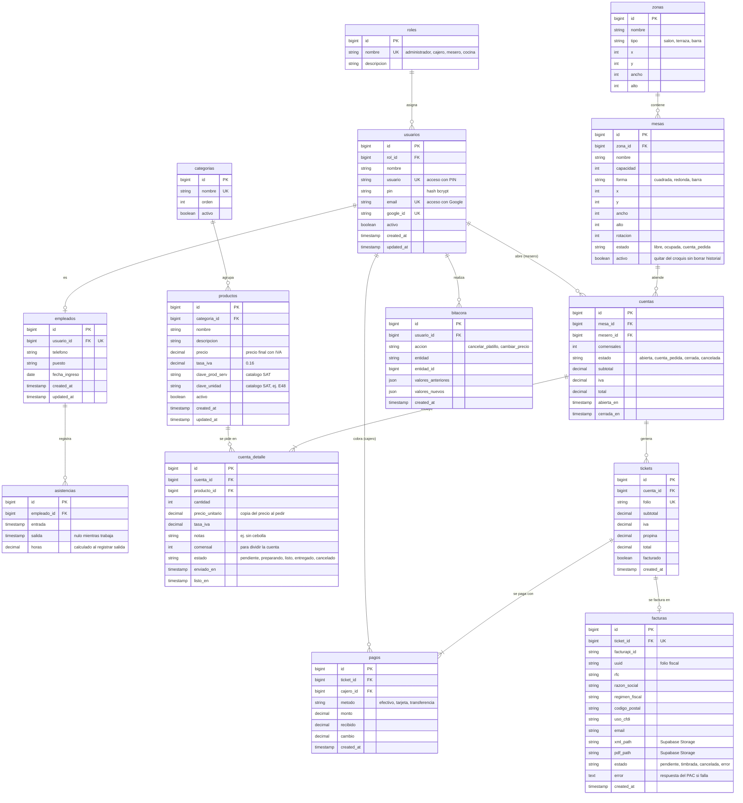

# Modelo de datos — MesaLista

Base de datos PostgreSQL alojada en Supabase. Las tablas se crean con migraciones de Laravel.

## Diagrama entidad-relación

## Decisiones de diseño

- **usuarios y empleados separados.** `usuarios` guarda cómo se entra al sistema (PIN o Google) y el rol; `empleados` guarda los datos de la persona. El administrador puede entrar con Google sin ser empleado de piso.
- **Precio con IVA incluido.** En México el precio del menú ya incluye IVA, así que se guarda el precio final y la tasa. El precio antes de IVA se calcula: `precio / (1 + tasa_iva)`, y el IVA es la diferencia. Así el precio que ve el cliente nunca cambia por redondeos.
- **Copia del precio en cada platillo pedido.** `cuenta_detalle.precio_unitario` guarda el precio del momento; si el administrador cambia el precio después, las cuentas anteriores no se alteran.
- **Una cuenta puede generar varios tickets.** Al dividir la cuenta, cada parte genera su propio ticket con folio único, y cada ticket se puede pagar con uno o más métodos (`pagos`). Cada ticket se factura por separado.
- **Croquis con coordenadas.** Zonas y mesas guardan `x`, `y`, `ancho`, `alto` (y `rotacion` en mesas) para dibujar el plano y moverlas arrastrando.
- **Estado de mesas y platillos en columnas propias.** Supabase Realtime escucha los cambios en `mesas.estado` y `cuenta_detalle.estado` para actualizar todas las pantallas al instante.
- **Datos fiscales del SAT en productos.** `clave_prod_serv` y `clave_unidad` son obligatorios para timbrar el CFDI 4.0.
- **Mesas que se desactivan.** `mesas.activo` permite quitar una mesa del croquis sin borrar las cuentas que tuvo; por la misma razón, no se puede eliminar una mesa, cuenta o producto con historial.
- **Estados controlados por la base de datos.** Los campos `estado`, `tipo`, `forma` y `metodo` son `enum`: PostgreSQL rechaza cualquier valor fuera de la lista.
- **Facturas con seguimiento de errores.** Una factura nace como `pendiente`; si el PAC rechaza el timbrado se guarda su respuesta en `error` para poder corregir los datos y reintentar.
- **Bitácora con JSON.** Guarda los valores antes y después del cambio para saber quién canceló un platillo o modificó un precio, y cuándo.

Laravel crea además sus tablas internas (`personal_access_tokens` de Sanctum, `migrations`, `cache`, `jobs`).
